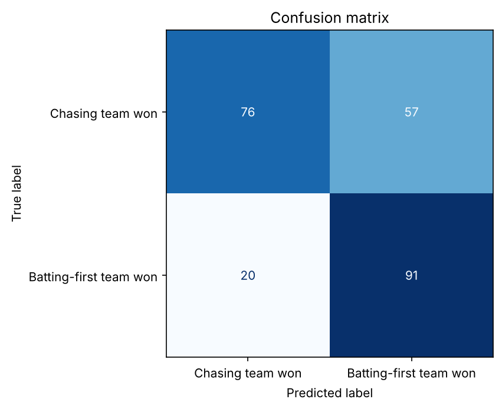
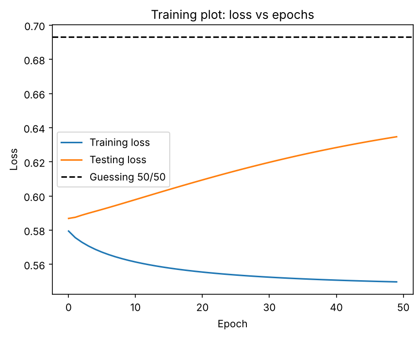
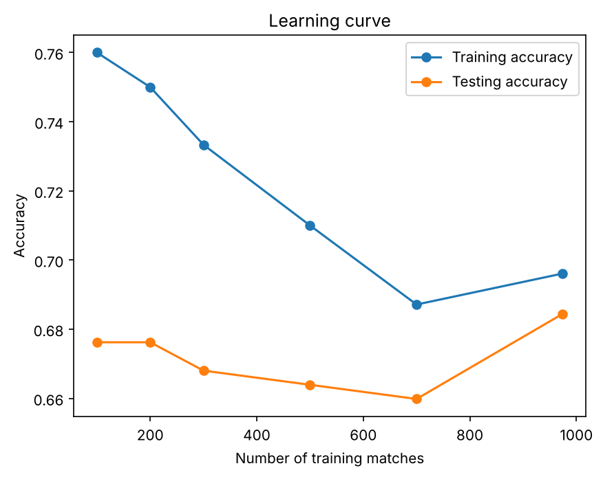
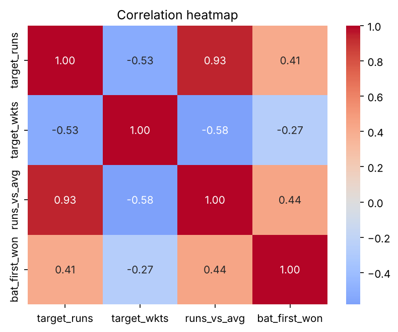

# IPL Match Winner Prediction using Logistic Regression

Predict whether the **team batting first** wins an IPL match, using only what is known at the **end of the first innings**: the score, the wickets lost, the two teams and the venue.

AI101: Data Science and AI Essentials with Python, IIT Ropar.

## Problem Statement

At the innings break we know the target, the wickets lost, who is chasing and where the match is played. Using only that information, we predict whether the team batting first wins (`1`) or the chasing team wins (`0`). Second-innings scores, win margins and player of the match are **not** used, because they are only known after the match and would give the answer away.

- **Target:** `bat_first_won` (`1` = batting-first team won, `0` = chasing team won)
- **Model:** Logistic Regression (`C=0.1`)
- **Prediction point:** end of the first innings

## Team Members and Roles

| Team member | Roll/ID | GitHub username | Role |
|---|---|---|---|
| Mannat | `2026AIB1055` | `2026aib1055` | Execution Lead |
| Ankit Bassi | `2026EEB1320` | `2026eeb1320` | Documentation Lead |
| Yatharth Garg | `2026ESB1501` | `2026esb1501-create` | Documentation Lead |
| Yash Meena | `2026EEB1426` | `2026eeb1426-ops` | PPT Lead |
| Alankrit Tripathi | `2026MCB1508` | `Alanlol2007` | Video Lead |

## Dataset

- **Source:** [IPL 2008–2026 Matches Dataset (Kaggle)](https://www.kaggle.com/datasets/arjunsinghgangwar/ipl-20082026-matches-dataset)
- **File:** `data/matches.csv` (included in this repository, so no download is needed)
- **Size:** 1,243 matches × 31 columns (one row per match: season, date, teams, toss, venue, runs and wickets of both innings, winner and other match details)
- **After cleaning:** 1,218 matches
- **Training set:** 974 matches (oldest 80%) · **Test set:** 244 matches (newest 20%)

## Project Structure

```text
ipl-match-winner-prediction/
├── data/
│   └── matches.csv                      # Dataset (included)
├── images/                              # Charts produced by the notebook (used below)
├── slides/
│   ├── IPL_Match_Winner_Prediction.pptx # 5-slide presentation
│   └── IPL_Match_Winner_Prediction.pdf  # Same slides as PDF
├── video/
│   └── project_demo_link.txt            # Link to the project video
├── ipl_match_prediction.ipynb           # Main notebook: data → model → results
├── requirements.txt
└── Readme.md
```

## Methodology

1. **Load data** from `data/matches.csv`.
2. **Clean team names** by merging renamed franchises (Delhi Daredevils → Delhi Capitals, Kings XI Punjab → Punjab Kings, Royal Challengers Bangalore → Royal Challengers Bengaluru, Rising Pune Supergiants → Rising Pune Supergiant).
3. **Remove matches without a valid winner** and sort matches by date.
4. **Work out the batting-first and chasing teams** from the toss winner and toss decision.
5. **Create features:**
   - `target_runs`: batting-first team's first-innings runs
   - `target_wkts`: wickets the batting-first team lost
   - `runs_vs_avg`: first-innings runs minus the average of the previous 60 matches (past matches only)
   - batting-first team, chasing team and venue (one-hot encoded)
6. **Split by time:** oldest 80% for training, newest 20% for testing, so the model never sees future matches.
7. **Scale numeric features** with `StandardScaler`, fitted on the training data only.
8. **Select the 15 best features** with `SelectKBest(f_classif, k=15)`, fitted on the training data only.
9. **Train Logistic Regression** and evaluate it on the test set.
10. **Train an SGD classifier for 50 epochs** to plot training/testing loss, and plot a learning curve.
11. **Predict a new match** with the `predict_ipl_winner()` function.

## Setup

**Requirements:** Python 3.10 or newer, and Jupyter Notebook (installed by `requirements.txt`).
Tested with Python 3.13 and 3.14, pandas 3.0, NumPy 2.5, scikit-learn 1.9, Matplotlib 3.11, Seaborn 0.13.

## How to Run

Run these commands in a terminal, in this order.

**1. Clone the repository**

```bash
git clone https://github.com/2026aib1055/ipl-match-winner-prediction.git
cd ipl-match-winner-prediction
```

**2. Create and activate a virtual environment**

```bash
python -m venv .venv
```

Windows:

```bash
.venv\Scripts\activate
```

macOS / Linux:

```bash
source .venv/bin/activate
```

**3. Install the libraries**

```bash
pip install -r requirements.txt
```

**4. Open the notebook**

```bash
jupyter notebook ipl_match_prediction.ipynb
```

**5. Run it:** select **Kernel → Restart & Run All**. The dataset path is relative (`data/matches.csv`), so nothing needs to be changed.

## Results

On the **244-match test set** (the newest matches, never seen in training):

| Metric | Result |
|---|---:|
| Accuracy | 0.684 |
| Precision | 0.615 |
| Recall | 0.820 |
| F1 score | 0.703 |
| ROC-AUC | 0.767 |
| MSE | 0.207 |
| MAE | 0.394 |
| RMSE | 0.455 |
| Baseline accuracy | 0.545 |

The baseline always predicts the most common outcome in the training data. The model is about **14 percentage points** more accurate than the baseline.

## Expected Output

**Confusion matrix:** most mistakes are chasing wins predicted as batting-first wins.



**Training loss vs epochs:** training loss falls while testing loss rises slightly (mild overfitting). Both stay below the 50/50 guessing line.



**Learning curve:**



**Correlation heatmap:**



**Predicting a new match.** The last cells of the notebook run:

```python
predict_ipl_winner(
    batting_first_team="Chennai Super Kings",
    chasing_team="Mumbai Indians",
    venue="Wankhede Stadium",
    first_innings_runs=185,
    first_innings_wickets=6
)
```

Expected output:

```text
Predicted winner: Chennai Super Kings
Chennai Super Kings win probability: 56.5%
Mumbai Indians win probability: 43.5%

Chennai Super Kings make 220/4:
Predicted winner: Chennai Super Kings
Chennai Super Kings win probability: 82.1%
Mumbai Indians win probability: 17.9%

Chennai Super Kings make 140/8:
Predicted winner: Mumbai Indians
Chennai Super Kings win probability: 20.5%
Mumbai Indians win probability: 79.5%
```

Higher runs and fewer wickets lost favor the batting-first team, though this provides a probability estimate, not a guarantee.

## Limitations and Future Work

**Limitations**
- Does not use ball-by-ball data, player quality, pitch conditions or weather.
- The evaluation is conducted on a restricted test set comprising only 244 matches.
- Cricket match outcomes inherently involve high uncertainty, particularly during high-pressure second-innings run chases.

**Future work**
- Add player statistics and recent team form.
- Add features from the chase (for example, the score after 10 overs) for a later prediction point.
- Try Random Forest or XGBoost and compare performance.

## Project Links

- **GitHub repository:** https://github.com/2026aib1055/ipl-match-winner-prediction
- **Presentation (5 slides):** [slides/IPL_Match_Winner_Prediction.pptx](slides/IPL_Match_Winner_Prediction.pptx) ([PDF](slides/IPL_Match_Winner_Prediction.pdf))
- **Project video (max 5 minutes):** see [video/project_demo_link.txt](video/project_demo_link.txt)

## AI-Use Disclosure

- **Claude:** used to help with some coding, and to find and fix a bug where the model was trained on unscaled features (which made the sample prediction wrong). We re-ran the notebook and checked the new results.
- **ChatGPT:** used to help draft the README and documentation. The team reviewed the documentation against the notebook and project requirements.
- **Gemini:** used to help draft slide templates.
- No AI was used to generate the dataset or the results.
- The team is responsible for the code, results and documentation, and can explain any part of the project.
